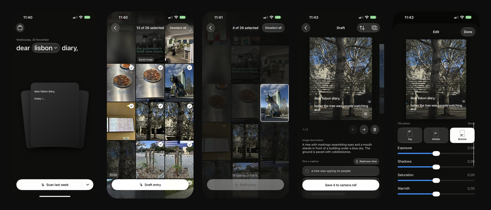

# Dear diary

An iPhone app for drafting photo-diary entries in the style of [Dear Lisbon diary](https://www.anshka.com/dear-diary): a series about the small, slightly absurd things you notice around a city.

It goes through your camera roll looking for the things you might walk past, suggests an order and a few captions for each photo, and exports every photo in 3:4 with the caption set in the series' type and margins.

Everything runs on the phone with Apple's free on-device model. No account, no API key, and your photos never leave the device.

## What it does

- **Scans your photos** from the last week or month, or lets you pick them yourself.
- **Filters out** faces, selfies, screenshots, saved images, documents and photos taken outside the city you're writing to, and keeps only the best of a run of similar shots.
- **Drafts an entry:** picks the photos with the most character, describes each one, then suggests three captions per photo. A second pass reads each caption back and drops the ones that don't make sense.
- **Rephrases your own line** while you type, keeping your idea, and checks its grammar.
- **Lets you arrange the entry:** reorder, choose the first photo (with "dear … diary,") and the last (with "until next time"), and set the text at the top, middle or bottom.
- **Edits each photo:** exposure, shadows, saturation, warmth, darkening behind the text, and grain across the entry.
- **Saves the finished entry** to your camera roll, in order, at 2160 × 2880.
- **Keeps every draft** so you can come back to it.

## Requirements

- A Mac with Xcode 27
- An iPhone that supports Apple Intelligence (iPhone 15 Pro or newer), on iOS 27, with Apple Intelligence turned on

## Run it on your iPhone

1. Download or clone this repository and open `DearDiary.xcodeproj` in Xcode.
2. Select the DearDiary target, open **Signing & Capabilities**, choose your own team (a free Personal Team works) and change the bundle identifier from `com.example.deardiary` to something unique, like `com.yourname.deardiary`.
3. Connect your iPhone, turn on Developer Mode (Settings › Privacy & Security), and press **Run**.
4. The first time, trust your developer profile on the iPhone in Settings › General › VPN & Device Management.

With a free Personal Team the app expires after 7 days; press Run again to reinstall it.

## Make it yours

- **Your voice:** the examples in `StyleGuide.swift` are lines from Dear Lisbon diary. Replace them with your own lines and what was in each photo. The app copies their voice, so this matters more than anything else. It also learns from the captions you keep.
- **Your city:** tap the city in the title to add cities. Only photos taken within 35 km of the selected city are used.
- **Your type:** caption size, margins and line spacing are in `CaptionSpec` in `ImageStyler.swift`.
- **Your icon:** the app icon is `DearDiary/AppIcon.icon`, a Liquid Glass icon made in Icon Composer. Open it there to change it.

## How the captions are made

Apple's on-device model is small, so the work is split into steps it can handle:

1. Apple's Vision framework labels each photo and reads any text in it.
2. The model writes a literal description of the photo, looking at the whole frame and a close-up of its most eye-catching part.
3. It picks a few of your example lines whose photos are most similar (using on-device sentence embeddings), writes four ideas about different things in the photo, then eight lines from them.
4. Code drops lines that are too long, too short or full of the model's favourite clichés.
5. A second pass explains each remaining line in plain words and scores how clearly it lands. Only the clear ones are shown, best first, plus one plain, true line as a fallback.

## License

MIT
